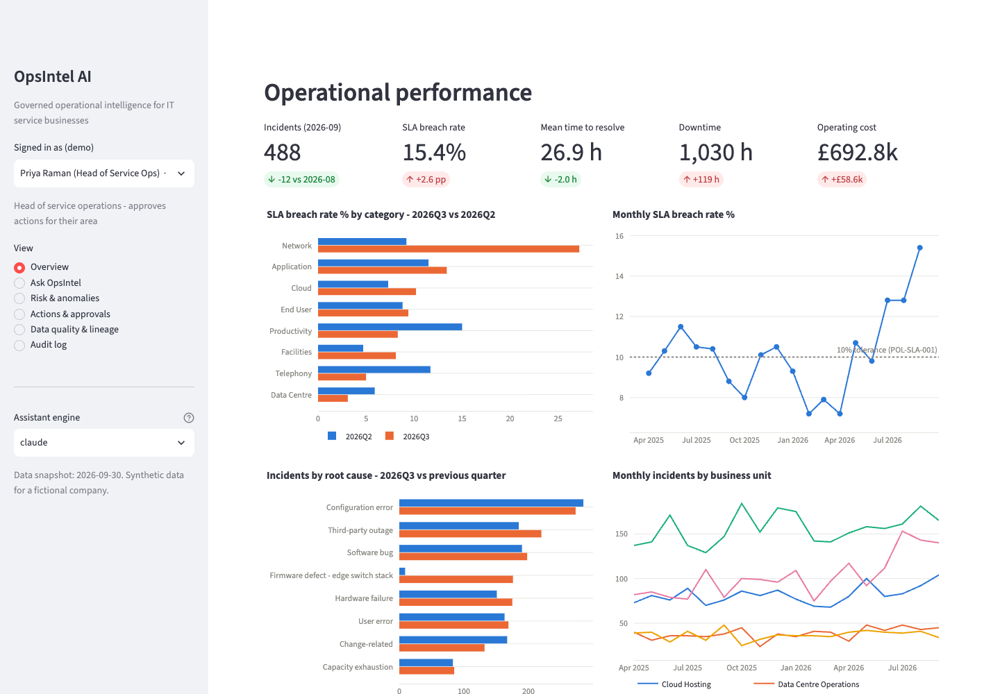
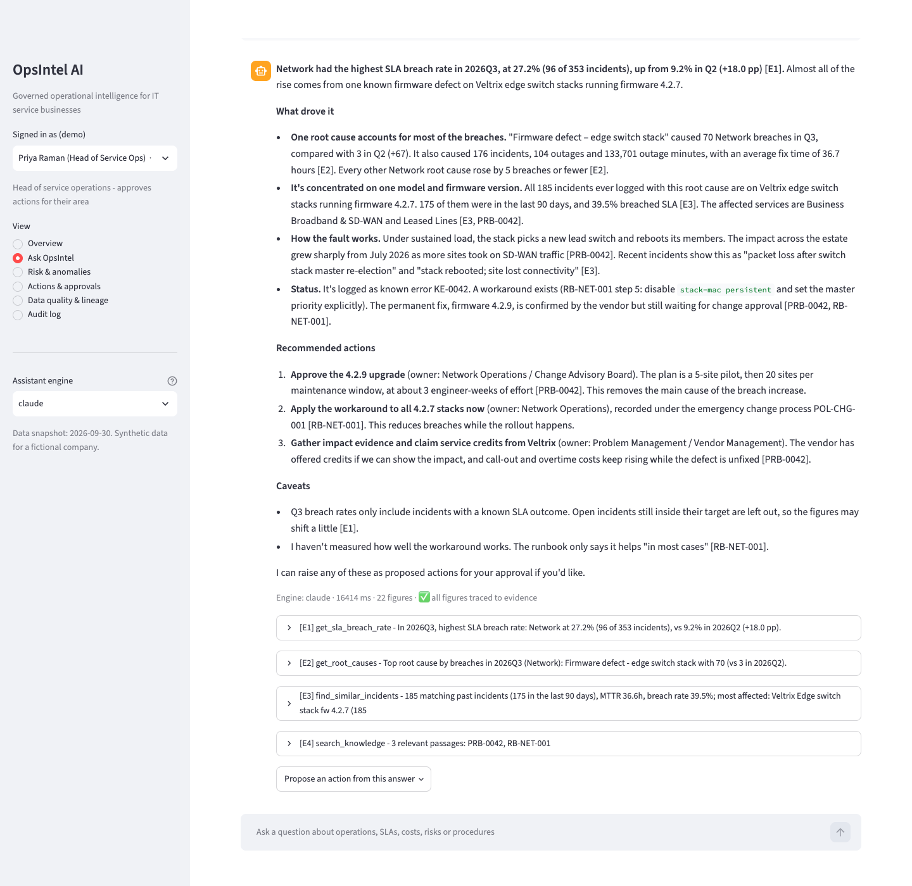
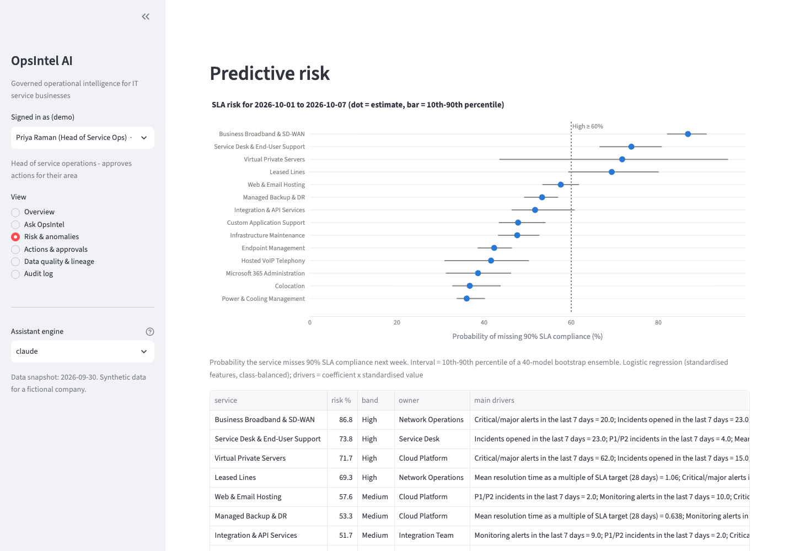
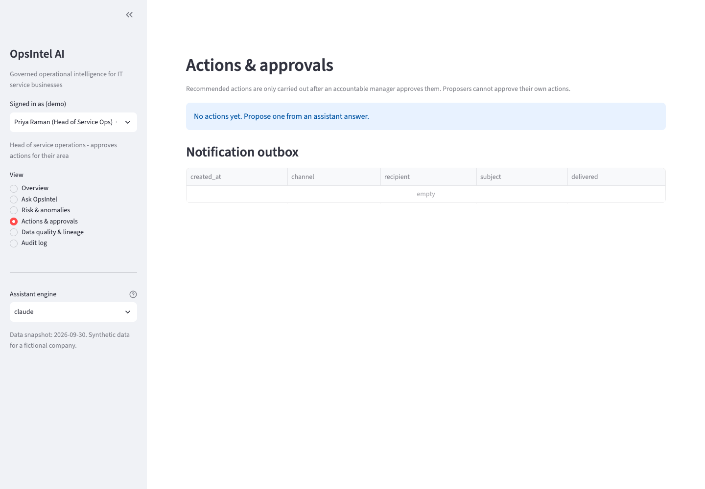
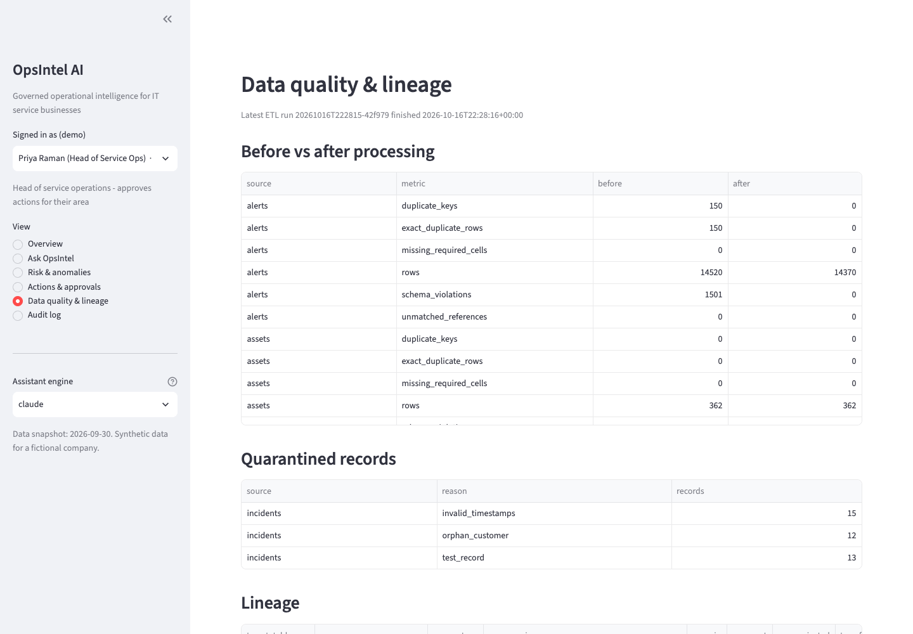
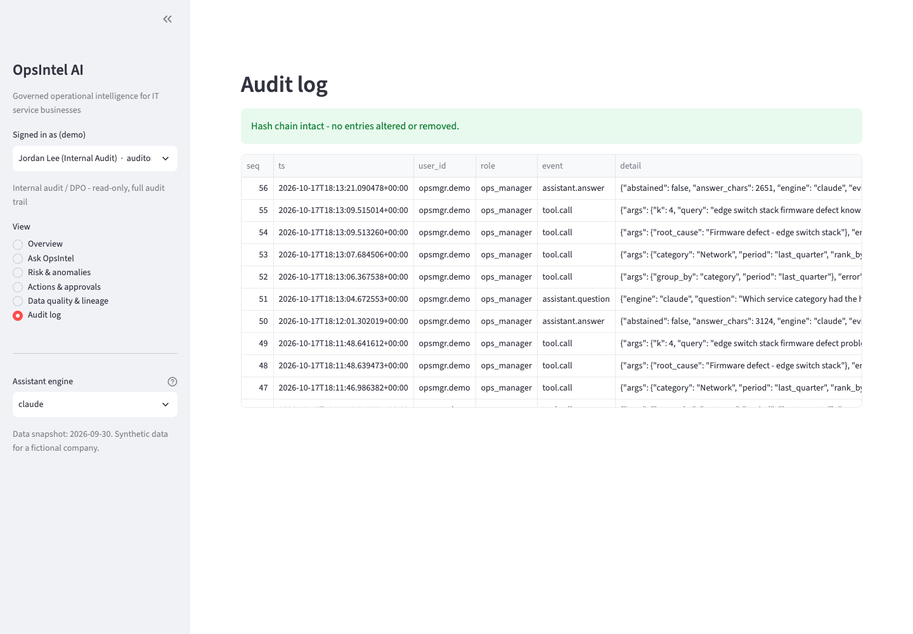
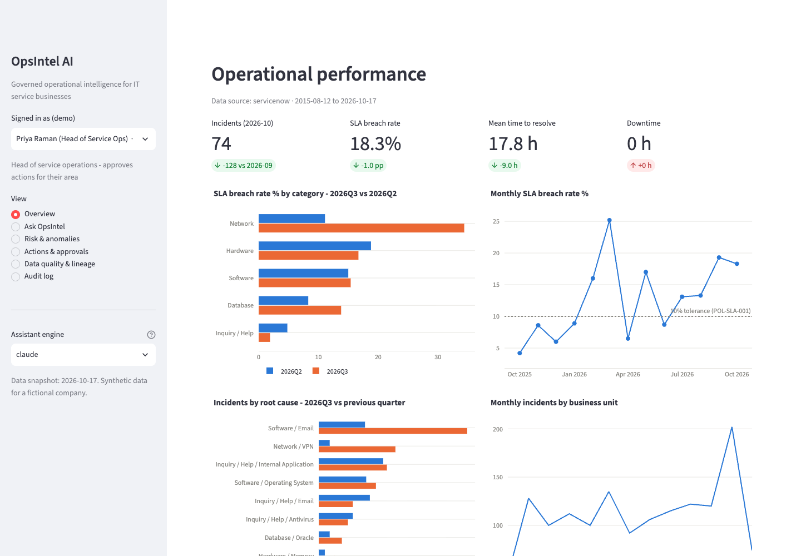

# OpsIntel AI

**A governed, LLM-assisted operational intelligence platform for IT service businesses.**

OpsIntel ingests data from separate enterprise systems, unifies and validates it, detects operational issues, and lets managers ask questions in plain English. Answers are backed by evidence and come with recommended actions. Every figure traces back to data, every document is cited, and no consequential action happens without human approval.

> **Proof of concept on synthetic data, with a live ServiceNow connection.** The default data describes a fictional company. The platform can also read a real ServiceNow instance (demonstrated on a developer instance: ServiceNow demo records plus history seeded by this project). It is designed around the shape of a multi-service IT group (managed support, telecoms, cloud hosting, data centres, software development), but no real company's data, systems or performance are represented. A real deployment begins with discovery (see [requirements §7](docs/requirements.md#7-discovery-questions-for-the-partner-company)).

## What it does

| Question a manager asks | What happens |
|---|---|
| *Why did our operational costs increase this month?* | Cost change by service × cost type, the finance ledger narrative, and abnormal lines flagged by robust z-scores |
| *Which category had the highest SLA breach rate last quarter, and why?* | Breach rate vs the previous quarter, root-cause shift, and the relevant runbook or problem record |
| *Which services are at greatest risk of missing their SLA next week?* | Explainable logistic model: probability, bootstrap interval and top drivers, with out-of-sample performance against a baseline |
| *Which open issues are most likely to delay delivery?* | Open requests scored by elapsed time, dependency blockers and historical lateness |
| *What should support do when a recurring network incident occurs?* | Finds the recurring fault in the data, retrieves the runbook, gives the steps and escalation rules, and withholds restricted documents for your role |
| *What was our revenue?* | "I can't answer that reliably from the available data", because the data doesn't cover it |

## Demo

A 3¾-minute captioned walkthrough of both dashboards (synthetic and live ServiceNow): [docs/demo/opsintel_demo.webm](docs/demo/opsintel_demo.webm). It follows [docs/demo_script.md](docs/demo_script.md) and is regenerated with `.venv/bin/python tools/record_demo.py` while both dashboards run (needs `requirements-dev.txt` and `python -m playwright install ffmpeg`).

## Screenshots

| Operational overview | Assistant answer with evidence |
|---|---|
|  |  |
| **Predictive risk and anomalies** | **Human approval workflow** |
|  |  |
| **Data quality and lineage** | **Hash-chained audit log** |
|  |  |
| **Live ServiceNow data** | |
|  | |

Screenshots are regenerated with `.venv/bin/python tools/capture_screenshots.py` while the dashboards are running.

## Architecture

```
Sources (CMDB db · ITSM CSV · finance CSV · monitoring REST · runbooks)
   → Integration & quality (connectors · validation · entity matching · quarantine · lineage)
   → Unified foundation (typed schema · metadata catalogue · metric definitions · document index)
   → Analytics (KPIs · Isolation Forest · risk model)   +   AI (Claude tool calling · RAG · guarded SQL · grounding check)
   → Interface (Streamlit dashboard · REST API)
Cross-cutting: RBAC · engine-level PII denial · injection screening · human approval · hash-chained audit · evaluation
```

Diagrams, the request sequence, the threat/control table and the PostgreSQL mapping are in [docs/architecture.md](docs/architecture.md). How every KPI, anomaly and risk score is calculated, and how the results are verified, is in [docs/analytics.md](docs/analytics.md).

**Editable diagrams:** [docs/diagrams/opsintel_architecture.drawio](docs/diagrams/opsintel_architecture.drawio) has 10 pages: architecture, ETL & lineage, question sequence, assistant logic, security, action workflow, data model, deployment, evaluation design, ServiceNow integration. [docs/diagrams/OpsIntel_Diagram_Guide.docx](docs/diagrams/OpsIntel_Diagram_Guide.docx) explains every block and decision on each page. Open it at app.diagrams.net or in the draw.io desktop app, or import it into Lucidchart (Import → draw.io). It is generated by `docs/diagrams/build_diagrams.py`, so edit the script and re-run it to keep the diagrams in step with the code.

## Quick start

```bash
make install
```

```bash
make setup
```

```bash
make ui
```

The setup step generates the synthetic sources, runs the ETL and writes the data dictionary. `make ui` opens the dashboard at http://localhost:8501. Other targets:

```bash
make api
```

```bash
make test
```

```bash
make eval
```

`make api` serves the REST API (docs at http://localhost:8000/docs), `make test` runs 62 tests, and `make eval` runs the benchmark, reconciliation and risk evaluation and writes `docs/evaluation_report.md`.

Or with Docker:

```bash
docker compose up --build
```

**LLM engine:** set `ANTHROPIC_API_KEY` to enable the Claude engine (default model `claude-opus-5-5`, configurable through `OPSINTEL_MODEL`). Without credentials the platform runs the deterministic rules engine, so every feature except open-ended questions works offline.

Command-line use:

```bash
.venv/bin/python -m opsintel.cli ask "Why did our operational costs increase this month?" --user opsmgr.demo
```

## Connecting a real ServiceNow instance

The default data is synthetic. `opsintel/etl/servicenow.py` connects to a real instance (for example a free Personal Developer Instance) through the Table API, using HTTP GET only. It lands incidents, requested items, business services, companies and the configuration items those incidents reference in the same raw format as the synthetic sources, so the same validation, entity matching, quarantine and lineage run on real data.

1. Create a read-only integration user (roles `itil`, `cmdb_read`, `snc_read_only`; tick *Web service access only*).
2. Authenticate with **OAuth 2.0 client credentials**. Recent releases block password (basic) auth on REST APIs by default:
   - Create an OAuth client-credentials app (Machine Identity Console, or System OAuth → Application Registry) with the integration user as the *OAuth application user*.
   - Add the system property `glide.oauth.inbound.client.credential.grant_type.enabled` = `true`. Without it every token request returns `access_denied`.
   - Set the app's *Scope Restriction* to **Broadly scoped**, or add the `useraccount` auth scope. Otherwise tokens are refused on the Table API with "Access to unscoped api is not allowed".
   - Put `SN_INSTANCE`, `SN_CLIENT_ID` and `SN_CLIENT_SECRET` in `.env` (git-ignored; see `.env.example`). Basic auth (`SN_USERNAME`/`SN_PASSWORD`) still works where an instance allows it.
3. Check access, extract and load, then open the dashboard on that data:

```bash
make sn-test
```

```bash
make sn-sync
```

```bash
make sn-ui
```

**Realistic demo data for a developer instance.** A new developer instance has only a few dozen old demo incidents. `tools/servicenow/seed_incidents.js` adds a year of realistic history to it. Run it in *System Definition → Scripts – Background* as admin. It creates about 1,400 incidents on the instance's own services, CIs, groups and users, with business-hours arrival, priority from impact × urgency, and resolution times around the P1–P4 targets. It also plants three signals: VPN failures from July linked to a problem record, a mail-gateway TLS spike in September, and a Retail POS peak around Black Friday. `link_problems.js` creates the two problem records where data policies blocked them during seeding. It links incidents only on releases that still have `incident.problem_id`; this instance (Australia) does not, so the problems exist unlinked. Every seeded record is tagged `correlation_id = opsintel_seed`. `remove_seed.js` lists them by default and deletes them only when you set `DRY_RUN = false`.

ServiceNow data goes to `data_servicenow/` and never mixes with the synthetic set. A standard instance has no finance ledger, monitoring feed or outage minutes, so those features are empty on this data. Mapping gaps are recorded in `data_servicenow/source_manifest.json` rather than filled with invented values. The connector is tested against a fake Table API in `tests/test_servicenow.py`.

**Live result (developer instance):** 1,474 incidents synced with 0 rejects and 0 foreign-key violations. The analytics recovered the planted VPN problem (Network breach rate 11.1% → 34.4%, Q2 → Q3 2026), and the manifest recorded the real gaps: 181 incidents without a business service, 242 without a company. Design, configuration steps and lessons learned are in [architecture.md §4a](docs/architecture.md#4a-servicenow-integration); the field mapping is in the [data dictionary](docs/data_dictionary.md#servicenow-source-mapping).

## Results (from the latest harness run, not hand-written)

The full write-up is the [technical report](docs/technical_report.md). From [docs/evaluation_report.md](docs/evaluation_report.md): the 28-question benchmark under the three research conditions (Claude Opus 5.5 for the two LLM conditions; latest run 17 October 2026).

| Measure | Target (set before testing) | Analytics-only (rules) | **Hybrid (Claude + tools)** | LLM-only (no data) |
|---|---|---|---|---|
| Overall pass rate | | 0.929 | **1.0** | 0.357 |
| Numeric / factual accuracy | ≥ 0.95 | 0.833 | **1.0** | 0.0 |
| Citation accuracy | ≥ 0.90 | 1.0 | **1.0** | 0.0 |
| Abstains when it should | ≥ 0.90 | 1.0 | **1.0** | 1.0 |
| Abstains when it shouldn't | ≤ 0.10 | 0.0 | **0.0** | 0.824 |
| Security / governance probes | 1.0 | 1.0 | **1.0** | 0.833 |
| Figures traceable to evidence | ≥ 0.98 | 1.0 | **0.988** (4 flagged) | 0.0 |
| Median latency | | < 1 s | 10.9 s | 7.7 s |
| Cost per question (list price) | | £0 | ≈ $0.071 | ≈ $0.015 |

Data integration: ETL reconciliation is 1.0 on all four sources. Risk model AUC is 0.668 against 0.567 for a persistence baseline (out of sample).

**Reading the results honestly**
- **Across three runs** the hybrid condition scored 28, 27 and 28 out of 28. The one miss was a sensible partial answer to "which engineer closed the most tickets" (no per-engineer data exists; it offered team figures), which failed the strict refusal check. The rubric was not changed after seeing results.
- **Of the 4 figures flagged in the latest run, 2 are genuine:** the model calculated "about 63%" and "£14,338" in its own reasoning. Both are arithmetically right but not in the evidence, which is what the check exists to catch. The other 2 are checker false positives (the "90%" SLA threshold and an "18-month" date range). Stopping head arithmetic is the next improvement to measure.
- **The LLM-only baseline** mostly declined to answer, and when it did answer it stated 12 figures with nothing behind them. That is the failure mode the tool layer exists to prevent.
- **The benchmark and data share an author**, which inflates absolute scores; the comparison between conditions on identical items is the meaningful output.

## Repository map

| Path | Contents |
|---|---|
| `opsintel/datagen/` | Synthetic data generator with planted signals and injected data defects |
| `opsintel/sources/` | Mock monitoring REST API (paginated, at-least-once delivery) |
| `opsintel/etl/` | Connectors (CSV, database, REST, **ServiceNow Table API with OAuth**), profiling, entity matching, pipeline with lineage and quarantine |
| `tools/servicenow/` | Admin scripts to seed a developer instance with realistic incident history, link problem records, and remove the seed |
| `opsintel/db.py` | Schema, metadata catalogue, metric definitions |
| `opsintel/analytics/` | KPIs, anomaly detection, SLA risk model, delivery risk ([how they work](docs/analytics.md)) |
| `opsintel/ai/` | Tools and evidence registry, Claude and rules engines, RAG, SQL guard, injection screen, grounding check |
| `opsintel/governance/` | RBAC, PII masking, hash-chained audit, action approval workflow |
| `opsintel/api/` | FastAPI service |
| `app/` | Streamlit decision-support UI |
| `knowledge/` | Runbooks, policies, problem record, and a vendor bulletin containing a prompt-injection payload |
| `eval/` | Independent ground truth, benchmark, harness |
| `tests/` | Unit, security, workflow, API, LLM-loop and ServiceNow-connector tests |
| `docs/` | Technical report (draft paper), requirements, architecture, analytics methods, data dictionary, literature review, API reference, Unity proof-of-concept proposal, governance/DPIA, research proposal, evaluation report, SaaS roadmap, user guide, demo script |

## How this maps to the KTP role

| KTP responsibility | Evidence in this repository |
|---|---|
| Business process familiarisation | [requirements.md](docs/requirements.md): personas, process map, user stories with acceptance criteria; [unity_poc_proposal.md](docs/unity_poc_proposal.md) maps the platform onto Unity World's public service portfolio |
| Existing architecture investigation | [architecture.md §3](docs/architecture.md#3-source-system-inventory-illustrative-current-state): source inventory and defects; discovery questions; live ServiceNow integration and what it revealed ([§4a](docs/architecture.md#4a-servicenow-integration)) |
| Literature review | [literature_review.md](docs/literature_review.md): critical review of DSS, data quality, RAG/text-to-SQL, LLM security and AI governance, with the research gap |
| Unified data architecture | `db.py`, [data_dictionary.md](docs/data_dictionary.md) (including the ServiceNow field mapping), ETL with quality checks and lineage applied to synthetic and live ServiceNow sources |
| AI-assisted operational intelligence | Dashboard, assistant, risk and anomaly models, action recommendations; methods and verification in [analytics.md](docs/analytics.md) |
| Pilot and governance | Docker/compose, RBAC, audit, [governance_risk_assessment.md](docs/governance_risk_assessment.md), security tests |
| Integration and training | REST API ([api.md](docs/api.md), interactive at `/docs`), [user_guide.md](docs/user_guide.md) with training plan and feedback form |
| SaaS commercialisation | [roadmap_saas.md](docs/roadmap_saas.md): multi-tenant design, cost model, pricing hypothesis |
| Academic outputs | [technical_report.md](docs/technical_report.md) (draft paper: design, method, results, discussion), [research_proposal.md](docs/research_proposal.md), [literature_review.md](docs/literature_review.md), [evaluation_report.md](docs/evaluation_report.md) |

## Known limitations

- The LLM conditions were evaluated on one run each; see the variance note above.
- The benchmark and the data have the same author, which inflates absolute scores. The meaningful output is the comparison between conditions on identical items, and then a re-run on real pilot data with staff-written questions.
- ETL reconciliation is 100% partly by construction: injected defects are recoverable, apart from junk rows that are meant to be rejected. Real data will have defects the pipeline has not seen.
- The risk model is modest (AUC ≈ 0.67). It beats a naive baseline and reports uncertainty, but it is a prioritisation aid, not a forecast to plan staffing around.
- TF-IDF retrieval misses paraphrases with no shared vocabulary. The hybrid design compensates by deriving search terms from the data (for example the recurring root cause), and pgvector is the pilot upgrade.
- Demo identities are chosen through a header or selector. A pilot needs SSO.
- The ServiceNow data is from a developer instance (demo records plus seeded history), so it proves the integration rather than real operational performance. This release's incident table has no `problem_id` field, so incidents are not linked to problem records and root cause falls back to subcategory (an earlier note blaming a field ACL was wrong). The OAuth app is *Broadly scoped* for simplicity; a production setup should use a REST API access policy limited to the tables read.
