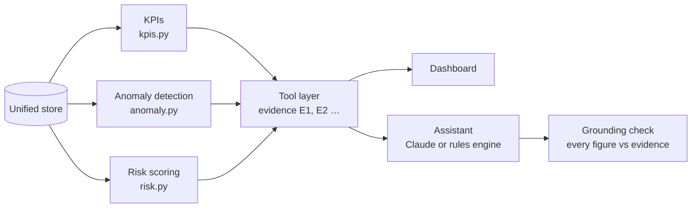

# How the analytics work

The analytics layer (`opsintel/analytics/`) is deterministic Python and SQL. There is no AI in it: every number comes from a defined, tested calculation. The assistant can only *call* these functions as tools; it never computes figures itself.



## 1. KPIs: fixed SQL with one definition per metric

[`kpis.py`](../opsintel/analytics/kpis.py) runs tested SQL against the unified store. Each function returns four things:

- the **rows** (the evidence),
- a **one-line summary** of the headline result,
- the **exact SQL** it ran, shown in the dashboard's evidence panel,
- a **chart hint** for the UI.

| Metric | How it is calculated |
|---|---|
| **SLA breach rate** | Breached incidents ÷ incidents whose SLA outcome is known, compared with the previous period. A *resolved* incident breached if its resolution hours exceed the target for its priority (P1 4 h, P2 8 h, P3 24 h, P4 72 h). An *open* incident counts as breached once it is past target; an open incident still within target is "not yet known" and is excluded. |
| **Root causes** | Incidents grouped by root cause and ranked by count, breaches or outage minutes, with the change against the previous period. That change is how "what explains it?" is answered. |
| **Downtime causes** | Outage minutes by root cause over the trailing 6 months, with each cause's share of the total. A cause is *recurring* if it appears in at least half of those months (minimum 3). |
| **Cost change** | This month vs last month by service × cost type, ranked by increase, carrying the finance ledger's own description of each line (e.g. "Hypervisor licence true-up"). |
| **On-time delivery** | Share of closed service requests that met their due date, by request type. |
| **Improvement priorities** | `score = 50 × (area's share of all hours beyond SLA or due date) + 50 × (area's share of all outage minutes)`. Incident categories and request types are ranked together, so "which process first?" compares like with like. The 50/50 weights are a judgement call to agree with service owners. |
| **Open backlog** | Open incidents by service, how many are already past target, and their average age. |
| **Headline tiles** | This month vs last month for incidents, breach rate, mean time to resolve, downtime and cost. A figure the data cannot supply (e.g. cost on ServiceNow data) shows as *n/a*. |

**Periods** are worked out relative to the end date of the data, not today's date:

| Phrase | Meaning |
|---|---|
| This month | The month containing the data's end date |
| Last quarter | The latest *complete* quarter (Q3 2026 on both data sets) |
| This quarter | The quarter containing the end date, which may be partial |
| Q2 2026, August 2026 … | Exactly that period |

A period outside the data's range raises a clear "no data for …" message rather than returning an empty or misleading result.

**One definition per metric.** Metric definitions are written once in `db.py` (`METRIC_DEFINITIONS`), so the KPI code, the assistant and the evaluation's independent ground truth all measure the same thing. They are also published in [data_dictionary.md](data_dictionary.md).

## 2. Anomaly detection

[`anomaly.py`](../opsintel/analytics/anomaly.py) uses two methods.

**Operational anomalies (Isolation Forest).**

- A separate model per service (200 trees) runs on five daily signals: incidents, SLA breaches, monitoring alerts, critical/major alerts and outage minutes.
- Each service's signals are first standardised against that service's own normal, so a busy service is not flagged just for being busy.
- About the 2% most unusual service-days are flagged (`contamination = 0.02`). The report names the signal that drove each one, as a z-score.
- Example: on the ServiceNow data it flagged 18 September on the Email service (z = 12.7), the peak of the planted mail-gateway failure.

**Cost anomalies (robust z-score).**

- For each cost line (service × cost type), this month's month-on-month change is compared with that line's own history of changes.
- It uses the median and median absolute deviation (MAD): `z = 0.6745 × (change − median) / MAD`.
- Lines with |z| ≥ 3.5 are flagged.
- Robust statistics are used because the mean and standard deviation would be pulled around by the very outliers being looked for.

## 3. Next week's SLA risk

[`risk.py`](../opsintel/analytics/risk.py) predicts, for each service, the probability that it misses 90% SLA compliance next week.

**Training data.** One row per service per week, with 8 features from the previous 7–28 days:

| Feature | Window |
|---|---|
| Incidents opened | 7 days |
| SLA breaches | 7 days |
| SLA breach rate | 28 days |
| Monitoring alerts | 7 days |
| Critical/major alerts | 7 days |
| Alert trend (this week vs average of the prior 3 weeks) | 7 vs 21 days |
| Mean resolution time as a multiple of target | 28 days |
| P1/P2 incidents | 7 days |

The **label** is whether the *following* week missed 90% compliance (more than 10% of its incidents breached).

**Model.** Logistic regression with standardised features and class balancing. It was chosen for explainability: each prediction lists its top drivers, where a driver's contribution = the model's weight for that feature × how far that service's value is from normal. A service owner can see *why* a service is flagged.

**Uncertainty.** 40 models are trained on resampled data (a bootstrap). The dashboard shows the 10th–90th percentile of their predictions as a range alongside the estimate, and bands each service High (≥ 60%), Medium (≥ 35%) or Low.

**Honest testing.** The model is trained on older weeks and tested on the most recent 26 weeks, which it has never seen. It is compared with a naive "same as last week" guess.

| Data set | Model AUC | Baseline AUC | Model Brier | Baseline Brier |
|---|---|---|---|---|
| Synthetic | 0.668 | 0.567 | 0.233 | 0.408 |
| ServiceNow (seeded history) | 0.647 | 0.637 | 0.220 | 0.191 |

AUC measures ranking (1.0 perfect, 0.5 chance); Brier measures probability accuracy (lower is better). On synthetic data the model clearly beats the baseline. On the ServiceNow data it is barely better at ranking and worse calibrated, so treat it as a prioritisation aid, not a forecast. If there is too little history to train and test, it says so rather than predicting.

**Delivery risk for open service requests** is a deliberately simple rule anyone can check:

```
score = 40 × (share of the target time already used, capped at 1)
      + 30 if blocked on a dependency (e.g. "awaiting carrier wayleave")
      + 30 × (that request type's late rate over the last 6 months)
overdue requests score 100
```

## 4. How the assistant uses the analytics

1. The assistant (Claude or the rules engine) chooses **tools**: 16 in total, wrapping the functions above, plus document search and a guarded read-only SQL tool for anything else.
2. Each tool result is checked against the user's role, has personal data masked and injected instructions screened, then becomes numbered **evidence** (E1, E2 …) with its SQL.
3. The answer must cite that evidence. A **grounding check** then confirms every figure in the answer appears in (or is a rounding of) a number in the evidence. Untraceable figures are flagged in the UI. In evaluation this caught Claude approximating "about 91%" in its head.

## 5. How it is verified

| Check | What it shows |
|---|---|
| **Independent ground truth** (`eval/ground_truth.py`) | Key answers are recomputed with pandas directly from the generator's clean truth tables, without the platform's SQL. Tests and the evaluation check they agree, so a bug in the KPI code cannot mark itself correct. |
| **Planted stories recovered** | Synthetic: Network breach rate 9.2% → 27.2% from a switch firmware defect; September costs up £58.6k from licence true-ups. ServiceNow seeded history: Network breach rate 11.1% → 34.4% from VPN failures; email incidents 14 → 95 in the September mail-gateway spike. |
| **Out-of-sample risk evaluation** | As in §3, recomputed on every evaluation run. |
| **Automated tests** | `tests/test_kpis.py` (KPIs vs truth, periods, risk model vs baseline), `tests/test_assistant.py` (grounding), plus the evaluation harness. |

## 6. Limitations

- **Root cause is only as good as what is recorded.** On synthetic data it is a recorded root-cause code. On ServiceNow it is the incident subcategory (e.g. "Network / VPN"), because this release has no incident-to-problem link.
- **The risk model is modest.** It should guide where to look first, not plan staffing.
- **Improvement-priority weights are a judgement call.** The 50/50 split should be agreed with service owners in a real deployment.
- **Some analyses need data a source may lack.** Costs, monitoring alerts and outage minutes are not in a standard ServiceNow instance, so those analyses report "not available from this source" instead of guessing.
