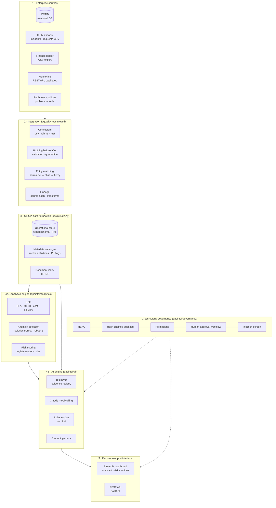
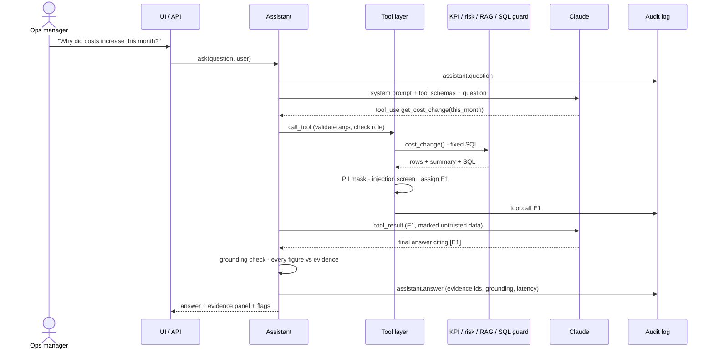

# Architecture

OpsIntel is a layered platform, not a chat window on a database. Each layer can be tested on its own, and the language model sits on top of a deterministic analytics layer it cannot bypass.

## 1. Layered view

## 2. Request path for one question

The model never touches the database directly. It can only call tools; each call is validated, permission-checked, executed by deterministic code, screened and recorded as numbered evidence. After the answer is written, a grounding check compares every figure in it with the evidence and flags any that do not match.

## 3. Source-system inventory (illustrative current state)

This is the kind of inventory to confirm with the partner company during discovery. **None of it describes a real company's systems.**

| Source | Typical system | Interface used here | Defects handled |
|---|---|---|---|
| CMDB (services, assets, customers, SLA definitions) | ServiceNow CMDB / Halo / Autotask | Read-only SQL extract | Primary-key duplicates |
| Incident and request records | ServiceNow / Halo ITSM | Scheduled CSV export | Duplicates, stale versions, mixed date formats, free-text service names and typos, missing priority, test tickets, impossible timestamps, orphan customers |
| Finance ledger | Xero / Sage / Dynamics | Monthly CSV export | Currency strings, inconsistent month format, re-export duplicates |
| Monitoring | PRTG / LogicMonitor / Zabbix | Paginated REST API | At-least-once duplicate events, inconsistent severity case, asset-only references |
| Knowledge | Confluence / SharePoint / ITSM KB | Markdown files with front-matter classification | Embedded prompt-injection text |

## 4. Data flow and lineage

Every ETL run writes:

- `etl_runs`: run id, timing, status
- `lineage`: per target table, the source URI, SHA-256 of the source payload, rows in/out/rejected and the ordered list of transforms (for example `parse_datetimes → drop_exact_duplicates(…) → keep_latest_version_per_incident(…) → entity_match_service({...}) → impute_priority_from_impact_urgency(121)`)
- `dq_results`: the same quality metrics measured **before** and **after** processing, per source
- `etl_rejects`: every quarantined record, with its reason and original payload, so nothing is silently dropped

## 5. Security architecture

| Threat | Control | Where |
|---|---|---|
| Model writes or deletes data | Read-only connection (`mode=ro`), `PRAGMA query_only`, SQLite **authorizer** permits only SELECT/READ. The assistant has no write tool apart from *proposing* an action | `ai/sql_guard.py` |
| Model reads data outside the user's role | Per-role table allow-list enforced inside the SQL engine and at the tool layer (e.g. service desk cannot read `costs`) | `governance/rbac.py`, `ai/tools.py` |
| Personal data exposure | Column-level deny on contact e-mail, phone and account manager (enforced by the engine, so it also holds through views and CTEs); PII-free `customers_safe` view; regex masking on every output | `sql_guard.py`, `pii.py` |
| Indirect prompt injection via documents or ticket text | Paragraph-level injection screen on retrieved passages and query results; tool output wrapped as `trust="untrusted-data"`; system prompt rule; no tool can approve actions | `ai/injection.py`, `ai/tools.py` |
| Expensive or runaway queries | Wall-clock timeout via progress handler, row cap, function allow-list | `sql_guard.py` |
| Numeric hallucination | Grounding check on every answer; ungrounded figures flagged in the UI and counted in evaluation | `ai/grounding.py` |
| Unauthorised consequential actions | Propose → approve workflow, role check, segregation of duties (proposer cannot approve), evidence required | `governance/actions.py` |
| Tampering with the audit trail | SHA-256 hash chain over every entry; `verify()` locates the first altered entry | `governance/audit.py` |
| Model safety refusal mid-workflow | `stop_reason == "refusal"` handled as an explicit abstention; server-side fallback (`fallbacks: "default"`) enabled | `ai/assistant.py` |

## 6. Mapping to PostgreSQL for a pilot

The MVP uses SQLite so it runs anywhere with no services. For a multi-user pilot:

| MVP | PostgreSQL pilot |
|---|---|
| SQLite file | PostgreSQL 16 managed instance |
| `mode=ro` + authorizer | Dedicated `opsintel_assistant` role with `SELECT` grants on a reporting schema only; column privileges revoke PII columns; `statement_timeout`; `default_transaction_read_only = on` |
| Role table allow-lists | Schema-per-audience + row-level security policies (e.g. per business unit) |
| TF-IDF index | `pgvector` embeddings with the same `search()` interface; hybrid BM25 + vector ranking |
| `audit_log` hash chain | Same, plus write-once export to object storage with retention lock |
| Demo `X-User` header | OIDC (Entra ID) bearer tokens; group claims → roles |
| CSV drops | ServiceNow Table API / scheduled export, incremental by `sys_updated_on` |

## 7. Why these technology choices

- **SQLite → PostgreSQL**: zero-setup reproducibility for reviewers; the SQL is portable, and the read-only enforcement concept carries over to database roles.
- **TF-IDF retrieval**: the corpus is small, procedural and vocabulary-rich, and results are deterministic, so evaluation runs are repeatable. The interface is the same as an embedding retriever's, so it can be replaced later.
- **Logistic regression for risk**: explainable per-feature contributions, calibrated-enough probabilities, and bootstrap intervals. It is honest about modest performance, and every prediction can be explained to a service owner.
- **Direct Anthropic SDK tool calling**, not a framework: the loop is about 40 lines and every step is visible and testable (see `tests/test_assistant.py`, which drives it with a scripted client).
- **Two engines**: the deterministic engine keeps the platform useful without an API key or during an LLM outage, and it is the *analytics-only* condition in the research design.
