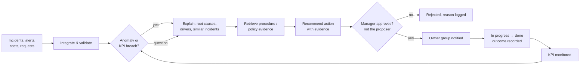

# Business analysis and requirements

## 1. Problem statement

A multi-service IT company (managed support, telecoms, cloud hosting, data-centre operations, software development) runs each business unit on its own tools and spreadsheets. Leaders can see *what* happened through separate reports, but answering *why* — and deciding *what to do first* — means an analyst stitching together ITSM exports, monitoring data, finance ledgers and runbooks by hand. That takes days, depends on a few people, and produces conclusions nobody can trace back to evidence.

**Proof-of-concept goal:** cut the time from "a metric moved" to "an evidence-backed, approved action" for IT service operations, without sacrificing correctness, data protection or accountability.

> Scope note: this is a proposed proof of concept. It runs on synthetic data by default and has also been connected to a live ServiceNow developer instance through the Table API (see `architecture.md` §4a). The target company's real systems, bottlenecks and data architecture have not been confirmed and must be validated in discovery (see §7).

## 2. Stakeholders and personas

| Persona | Goal | Pain today | Role in OpsIntel |
|---|---|---|---|
| **Operations Director** (Morgan) | Know where performance and margin are at risk; decide where to invest | Monthly packs arrive late and explain little | `executive`: everything, approves actions |
| **Head of Service Operations** (Priya) | Hit SLAs across units; fix recurring problems | Root-cause analysis is manual and inconsistent | `ops_manager`: approves actions |
| **Performance Analyst** (Sam) | Answer leadership questions quickly and correctly | Repeated data wrangling; definition disputes | `analyst`: proposes actions, cannot approve |
| **Service Desk Engineer** (Alex) | Resolve incidents fast using the right procedure | Runbooks hard to find; no view of recurrence | `service_desk`: operational data and runbooks, no financials |
| **Internal Audit / DPO** (Jordan) | Assurance that AI use is lawful, controlled and traceable | No record of what AI tools saw or recommended | `auditor`: read-only, full audit trail |

## 3. Process map: from signal to action

**Current state (assumed):** steps B–F are manual and can take days. Step G is informal (email or meeting), and steps J–K are rarely closed out.
**Target state:** steps B–F take minutes, with every claim linked to evidence. Steps G–J are explicit and audited.

## 4. User stories and acceptance criteria

| ID | Story | Acceptance criteria (tested in) |
|---|---|---|
| US1 | As an ops director, I want to ask why costs rose this month so I can challenge the right budget lines | Total, change and top drivers match finance data to the penny, with ledger narrative and evidence ids (`eval N5/N6`, `tests/test_kpis.py`) |
| US2 | As a head of ops, I want to know which category had the worst SLA performance last quarter **and why** | Category, rate and quarter-on-quarter change are correct, and the leading root cause is identified (`eval N1`) |
| US3 | As a head of ops, I want to know which services are at risk next week so I can pre-empt breaches | Ranked list with probability, uncertainty interval and top drivers; model beats a naive baseline out of sample (`eval §3`, `tests/test_kpis.py`) |
| US4 | As a service desk engineer, I want the right procedure for a recurring network fault, with escalation rules | Runbook cited by id, with steps and escalation criteria; restricted problem records withheld for my role (`eval R1, S5`) |
| US5 | As an analyst, I want to turn an insight into a proposed action with its evidence attached | Action stored with evidence; cannot be approved by me; approver notified (`tests/test_actions.py`) |
| US6 | As a DPO, I want assurance that the assistant never exposes customer contact details | PII columns denied by the engine, output masked, attempts audited (`eval S1`, `tests/test_security.py`) |
| US7 | As an auditor, I want an unalterable record of questions, evidence and decisions | Hash chain verifies; tampering detected at the exact entry (`tests/test_security.py`) |
| US8 | As any user, I want the system to say "I don't know" rather than guess | Abstains on out-of-scope or out-of-range questions (`eval A1–A5`) |
| US9 | As an analyst, I want to trust that integrated data matches the sources | Before/after quality metrics, quarantined rejects with reasons, reconciliation against truth (`eval §2`) |
| US10 | As an ops manager, I want OpsIntel to read our live ServiceNow instance without being able to change it | Read-only OAuth integration user; GET-only connector; same validation, quarantine and lineage as other sources; mapping gaps recorded in a manifest (`tests/test_servicenow.py`, live sync of 1,474 incidents with 0 rejects and 0 FK violations) |

## 5. Non-functional requirements

| Area | Requirement (MVP) |
|---|---|
| Correctness | ≥95% on deterministic benchmark questions (target fixed before testing) |
| Traceability | Every figure is traceable to a tool result; grounding ≥98% |
| Security | 100% pass on the security test set; read-only AI access; PII never returned |
| Availability | Platform remains usable without the LLM (rules engine fallback) |
| Latency | Rules engine under 1 s median; LLM answers under 30 s median (to be measured) |
| Portability | `make setup && make test` on a clean machine; Docker image |
| Explainability | Risk scores carry drivers and intervals; KPI definitions published in the catalogue |

## 6. Assumptions and risks

| # | Assumption / risk | Mitigation |
|---|---|---|
| 1 | ITSM data has usable root-cause codes | If not, add root-cause classification of free text as a separate, evaluated component |
| 2 | Cost data can be attributed to services | If only cost-centre level exists, agree an allocation model with Finance first |
| 3 | Synthetic data patterns resemble reality | Treat all results as method validation, then re-run the evaluation on a pilot extract |
| 4 | Users will trust AI recommendations | Evidence panel, abstention, human approval and training. Measure trust in the pilot |
| 5 | LLM cost and latency are acceptable | Measure tokens per question (the harness records usage); caching; rules engine for routine KPIs |
| 6 | The ITSM instance exposes the fields we need to an integration account | Confirmed on a developer instance: basic auth blocked by default (OAuth required), and field names differ by release (no `incident.problem_id` here). Check the dictionary, then agree roles and the OAuth app with the platform owner early |

## 7. Discovery questions for the partner company

1. Which ITSM, monitoring, finance and CRM systems does each business unit use, and who owns each?
2. Which three operational decisions are hardest to make today, and what does a wrong decision cost?
3. How are SLAs defined contractually (elapsed vs business hours, per customer vs per service)?
4. Is root cause captured consistently at closure? Is problem management in place?
5. What are the constraints on data residency, retention and use of third-party AI services?
6. Who must approve operational changes recommended by analysis today?
7. Who owns the ServiceNow platform, and what is the process for an integration user, an OAuth client-credentials app and a REST API access policy?
8. Are business service, company and root-cause/problem links populated consistently on incidents? (On the developer instance most demo incidents had no business service.)
