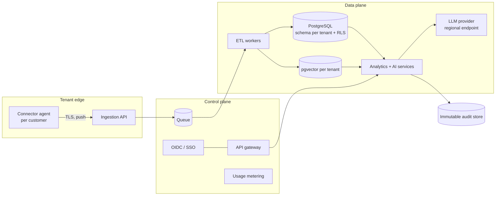

# Pilot plan, SaaS architecture and commercial hypothesis

_Everything commercial here is a **hypothesis to test**, not a forecast._

## 1. Pilot plan (12 weeks after discovery)

| Weeks | Activity | Exit criterion |
|---|---|---|
| 1–2 | Discovery: system inventory, data access, DPIA, pick 2 business units | Signed DPIA; read-only extracts agreed |
| 3–5 | Connect the live ITSM instance with the existing ServiceNow connector (integration user + OAuth app agreed with the platform owner), then monitoring and finance extracts; re-baseline data quality | Reconciliation report accepted by data owners |
| 6–7 | Re-write the benchmark with staff questions; run C1/C2 evaluation on real data | Targets met or gaps understood |
| 8–11 | Live use by 8–12 staff; weekly feedback; user study tasks | SUS ≥ 68; no security incidents |
| 12 | Review: value, risks, go/no-go for wider rollout | Board decision |

## 2. Multi-tenant SaaS architecture

Key decisions:
- **Isolation:** schema per tenant plus row-level security, with tenant id in every query context. Per-tenant encryption keys for the audit store.
- **Connectors:** ServiceNow is built (Table API, OAuth 2.0 client credentials, read-only, lands into the shared raw format - `opsintel/etl/servicenow.py`). Halo, Autotask, ConnectWise and common monitoring tools follow the same land-then-validate pattern.
- **Configurable semantics:** SLA definitions, metric definitions, role mappings and document classifications are tenant configuration, not code.
- **Model routing:** routine KPI questions go to the rules engine (no LLM cost); open questions go to the LLM. Prompt caching covers the stable system prompt and tool schemas.

## 3. Cost model (per tenant per month, illustrative)

| Item | Assumption | Monthly |
|---|---|---|
| LLM usage | 1,500 questions × **measured** ≈ 14k input + 0.9k output tokens (benchmark average, 2.6 model calls per question). At Claude Opus 5.5 list price ($4 / $20 per M tokens) that is ≈ $0.075 per question before caching | ≈ $112 (≈ £85) |
| Infrastructure share | Managed Postgres, workers, storage | £120 |
| Support and connector maintenance | 0.05 FTE | £250 |
| **Total cost to serve** | | **≈ £455** |

The token figure is measured by the harness (`usd_per_question` in `eval/results/latest.json`) on the benchmark questions. Real usage may differ. Prompt caching of the stable system prompt and tool schemas, plus routing routine KPI questions to the rules engine, should lower it further.

## 4. Pricing hypothesis

| Tier | For | Price hypothesis | Includes |
|---|---|---|---|
| Insight | Single-unit MSP, < 50 staff | £750 / month | Dashboards, rules engine, 2 connectors |
| Decision | Multi-unit, 50–250 staff | £1,800 / month | + AI assistant, risk scoring, action workflow, 5 connectors |
| Assured | Regulated customers | £3,500+ / month | + dedicated tenant, data residency, audit export, SSO/SCIM |

**Value test:** if the platform saves 1 analyst-day per week (about £1,000/month) and prevents one SLA service-credit event per quarter, the Decision tier pays for itself. Pilot metrics should confirm or reject this.

## 5. Product roadmap

| Horizon | Capability |
|---|---|
| Now (MVP) | Unified data, KPIs, anomaly + risk, hybrid assistant, governance, evaluation; live ServiceNow connector (OAuth, read-only) |
| Next (pilot) | Scheduled incremental ServiceNow sync, monitoring and finance connectors, PostgreSQL + pgvector, SSO, weekly risk digest; optional write-back of approved actions as ServiceNow problem/change tasks (separate, approved credential) |
| Later | Root-cause classification of free text, change-risk prediction, customer-facing SLA reports, multi-tenant SaaS |
